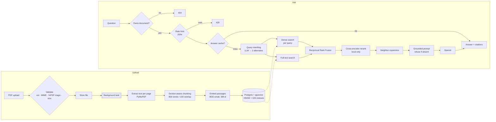

# Sourced — RAG Document Q&A

Upload a PDF, ask questions about it, and get answers **grounded in the document with page-level citations** — or an honest *"I don't have that information"* when the answer isn't there.

Built with FastAPI, PostgreSQL + pgvector, Redis, React, and OpenAI. Retrieval quality is **measured**, not guessed: a custom evaluation harness compares dense-only, hybrid, and reranked retrieval on the same document.

---

## Results

Retrieval evaluated on a **3,623-page PDF (1,682 chunks)** with 15 answerable questions. *hit@k* = a chunk containing the answer appears in the top *k* results. Full details in [`eval/RESULTS.md`](eval/RESULTS.md).

| Pipeline | hit@1 | hit@3 | hit@5 | hit@12 | Mean latency |
|---|:-:|:-:|:-:|:-:|:-:|
| Dense vector search (baseline) | 73.3% | 80.0% | 80.0% | 80.0% | 0.4 s |
| + Hybrid (vector + full-text, RRF) + query rewriting | 66.7% | 80.0% | 86.7% | **100%** | 2.6 s |
| + Cross-encoder reranking | **80.0%** | **86.7%** | 86.7% | **100%** | 6.9 s |

**What the numbers say**

- **Hybrid search improves recall.** Full-text search catches exact terms that embeddings miss (e.g. "disarm" → *Expelliarmus*), and query rewriting finds narrative passages phrased differently from the question. Every answer is now somewhere in the top 12.
- **…but recall isn't precision.** hit@1 *dropped* with hybrid search — fusing more ranked lists widens the net without sharpening the top result.
- **The reranker restores precision** (hit@1 66.7% → 80%) by scoring each (question, chunk) pair jointly — at a cost of ~4–7 s per query on CPU.
- The reranker is **enabled locally and disabled for free-tier hosting** (`RERANK_ENABLED=false`), where torch exceeds the memory limit. That is a deliberate latency/cost-vs-quality trade-off.

---

## Architecture



**Upload path:** the request returns immediately with `status: processing`; extraction, chunking, and embedding run in a background task, which ends in `ready` or `failed` (with an error message — never a permanent spinner).

**Ask path:** ownership check → rate limit → cache → retrieve → rerank → generate. Answers and chat history are persisted; each assistant message stores the exact chunks it was grounded on.

---

## Tech stack

| Layer | Choice | Why |
|---|---|---|
| API | **FastAPI** (ASGI) | Async I/O for DB/LLM/Redis calls; Pydantic validation; auto OpenAPI docs |
| Database | **PostgreSQL + pgvector** (Supabase) | Vectors, full-text search, and relational data in one store — no separate vector DB to sync |
| Vector index | **HNSW** (cosine) | Approximate nearest neighbour — fast at scale with a tiny recall trade-off |
| Keyword search | Postgres **`tsvector` + GIN** | Exact-term matching for names, numbers, and jargon that embeddings blur |
| Embeddings | **BAAI/bge-small-en-v1.5** via **fastembed (ONNX)** | Strong 384-d retrieval model; ONNX runtime avoids torch (same vectors, cosine 1.0000) |
| Reranker | **cross-encoder/ms-marco-MiniLM-L-6-v2** | Joint (query, chunk) scoring for precision on a small candidate set |
| LLM | **OpenAI** (`gpt-4o-mini`) | Grounded answer generation + query rewriting; model is configurable |
| Cache / limits | **Redis** (Upstash) | Answer cache, embedding cache, per-user hourly rate limit |
| Auth | **JWT + bcrypt** | Stateless auth; salted, deliberately slow password hashing |
| Frontend | **React (Vite)**, React Router, Axios | Context-based auth, interceptors for token + 401 handling, polling for processing status |

---

## Key design decisions

- **Hybrid retrieval fused with RRF.** Dense and full-text scores aren't comparable, so results are merged by *rank*: `score = Σ 1 / (60 + rank)`. Table-of-contents chunks are down-weighted so they don't dominate list-style questions.
- **Retrieve-then-rerank.** The cross-encoder is far more accurate than the bi-encoder but too slow to run over 1,682 chunks — so it only scores the fused top candidates.
- **Section-aware chunking with page ranges.** Chunks may cross page breaks within a chapter (so a scene isn't torn in half) but reset at headings. Each chunk stores `page_number` **and** `page_end`, so citations read "Pages 3–4" instead of under-reporting the source.
- **Grounded prompting with a fixed refusal.** The model answers only from the provided chunks, cites them as `[Chunk N]`, and replies with an exact refusal string when the answer is absent. Refusing is better than a confident hallucination.
- **Cache keys designed against contamination.** Answers: `answer:v{pipeline}:{doc_id}:{sha256(question)}` — the document ID prevents one document's answer leaking to another, and the pipeline version invalidates stale answers after retrieval changes. Embeddings: keyed by model, so a model swap never serves old vectors.

---

## Security

- **Ownership is checked first** in every document and chat handler — before rate limiting and before any cache read. If the cache were read first, any logged-in user could pass another user's `document_id` and receive their cached answers (an IDOR). Wrong owner returns **404, not 403**, so document IDs can't be probed.
- **Uploads are validated by content**, not just extension: `.pdf` extension, MIME type, `%PDF` magic bytes, and a size limit.
- **Parameterised SQL** everywhere, including vector queries (`CAST(:qvec AS vector)`).
- **Passwords** are bcrypt-hashed; `hashed_password` is never returned by the API.
- **Rate limiting** (Redis `INCR` + `EXPIRE`, 20 asks/user/hour → HTTP 429) caps LLM cost as well as abuse.

---

## Bugs found and fixed

A sample from [`NOTES.md`](NOTES.md):

| Bug | Impact | Fix |
|---|---|---|
| Chunks spanning pages stored only their start page | 1,676 of 1,682 citations under-reported their source | Added `page_end`; backfilled by re-chunking without re-embedding |
| Text-less (scanned) PDFs marked `ready` with 0 chunks | Every question silently refused | Fail the upload with an explicit "OCR not supported" error |
| Embedding cache key ignored the model | After switching models, stale vectors could be searched | Model name is part of the key |
| Upstash `redis://` URL | "Connection closed by server" | Upstash requires TLS (`rediss://`); auto-upgraded in code |

---

## Run locally

**Prerequisites:** Python 3.12, Node 20+, a Supabase (or any Postgres with pgvector) database, an Upstash (or any) Redis, an OpenAI API key.

```bash
# 1. Configure
cp .env.example .env              # fill in DATABASE_URL, REDIS_URL, OPENAI_API_KEY, SECRET_KEY
cp frontend/.env.example frontend/.env

# 2. Backend
cd backend
python -m venv venv
venv\Scripts\activate             # macOS/Linux: source venv/bin/activate
pip install -r requirements.txt

# 3. Database (once)
#    In the Supabase SQL editor, run scripts/enable_pgvector.sql, then:
python -m uvicorn main:app        # first start creates the tables; stop it (Ctrl+C)
python scripts/run_migrate_day4.py     # embedding column + HNSW index (⚠ empties document_chunks — new DBs only)
python scripts/run_migrate_hybrid.py   # full-text column + GIN index
python scripts/run_migrate_page_end.py # citation page ranges

# 4. Start the API → http://127.0.0.1:8000/docs
python -m uvicorn main:app --reload

# 5. Frontend → http://localhost:5173
cd ../frontend
npm install
npm run dev
```

**Evaluate retrieval** (from the repo root):

```bash
backend/venv/Scripts/python eval/run_eval.py --mode baseline
backend/venv/Scripts/python eval/run_eval.py --mode hybrid
backend/venv/Scripts/python eval/run_eval.py --mode full   # needs RERANK_ENABLED=true
```

> **Windows tip:** if the project path contains `&` or `—`, the `uvicorn.exe` / `npx` launchers break. Use `python -m uvicorn` and `node node_modules/vite/bin/vite.js`, or move the repo to a simpler path.

---

## Known limitations

- **No OCR** — scanned/image-only PDFs are rejected with a clear error.
- **Single-document Q&A** — each chat is scoped to one PDF.
- **English only** — full-text search uses the `english` configuration.
- **Reranker latency** — ~4–7 s/query on CPU; disabled for free-tier hosting.
- **Small eval set** — 15 questions on one document; results are directional, not definitive.
- **Background tasks run in the API process** — a restart mid-processing leaves a document needing reprocess.

## Future work

- OCR for scanned PDFs (e.g. Tesseract) and multi-document search
- Larger evaluation set across varied documents (papers, manuals, reports)
- Streaming answers (Server-Sent Events) to cut perceived latency
- A task queue (Celery/RQ) for processing, and a hosted or GPU reranker
- Semantic caching for paraphrased questions
